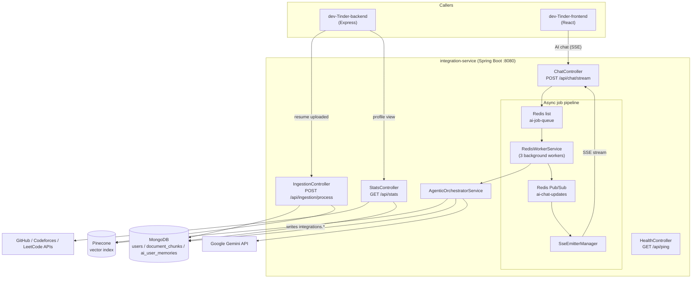
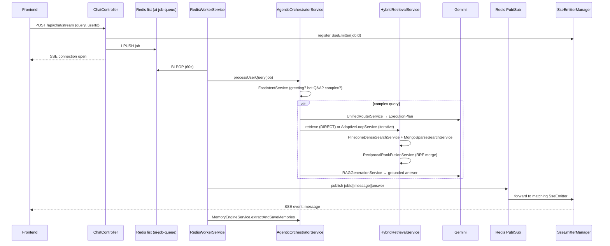
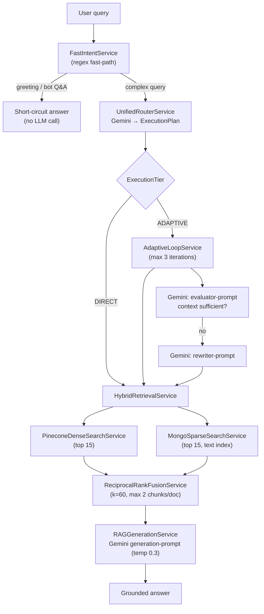
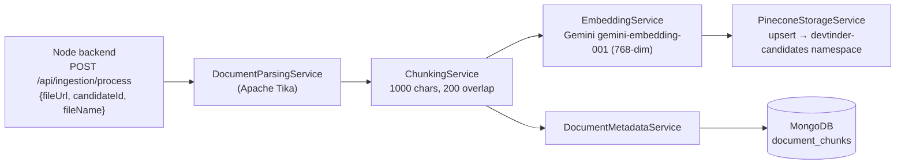

# DevTinder — Integration Service

Java 25 / Spring Boot 4 microservice that powers three things for DevTinder: **developer-platform stats aggregation** (GitHub/Codeforces/LeetCode), a **resume ingestion pipeline** (parse → chunk → embed → store), and an **agentic RAG "AI Recruiter" chat** over all ingested resumes.

## Tech stack

| Concern | Choice |
|---|---|
| Framework | Spring Boot 4 (Web MVC), Java 25 |
| Database | MongoDB (shared with the Node backend's `users` collection, plus its own `document_chunks` / `ai_user_memories`) |
| Vector store | Pinecone (`devtinder-intelligence-hub` index, `devtinder-candidates` namespace) |
| LLM | Google Gemini (routing, evaluation, query rewriting, generation, memory extraction, embeddings) |
| Job queue / fan-out | Redis — a blocking list (`ai-job-queue`) as the work queue, Pub/Sub (`ai-chat-updates`) to relay results to open SSE connections |
| Document parsing | Apache Tika |
| Build | Maven (wrapper included) |

## Why it exists

The Node backend owns users, connections and chat. This service does the heavier, LLM/vector-search-dependent work that doesn't belong in the request/response path of a Node API: talking to three external stats APIs, parsing and embedding PDFs, and running a multi-step retrieval-augmented chat agent. The Node backend and the React frontend both call into it directly, for different features.

## Architecture



## Agentic chat pipeline (the interesting part)

Standalone greetings (`hi`, `hii`, `hiii`, `hello`, `heyyy`) and basic bot
questions return a terminal SSE answer directly from the controller. They bypass
Redis, Mongo memory lookup, retrieval, Gemini, and memory extraction. The worker
also skips memory extraction for older queued fast-intent requests. Classification
uses the original message before memory is appended. A mixed request such as
"Hi, find React developers" follows the normal search pipeline.

All Gemini operations use the shared client in `service/gemini/`. It rotates
successful requests across the configured keys. HTTP 429 puts that key and model
on cooldown and tries the next available key, at most once per key per request.
Daily quota cooldowns last until the provider retry time or the next Pacific
midnight, whichever is later. Authentication failures (401/403) skip the rejected
key until restart. HTTP 503 receives at most two retries per operation, on the
same key, with roughly one- and two-second backoffs plus jitter. Persistent 503
failures show a service-busy message. Other failures are not automatically repeated across keys.
Generation and embedding cooldowns are separate, and concurrent requests share
the same thread-safe pool. Cooldowns are in memory and reset on service restart.

When no keys remain available, the chat pipeline stops with a clear SSE error,
no resume citations, and no memory-extraction call. Failed output is never
presented as a sourced answer. Quotas belong to Google Cloud projects; adding
more keys from the same project does not increase that project's allowance.

When localhost and Render share Redis, set `AI_REDIS_NAMESPACE=devtinder-local`
in the local `.env`. This isolates both the job queue and the SSE update channel.
Leave the variable unset on existing Render deployments to preserve their queue
names. Never run local workers against a production queue. The worker polls for
five seconds with a fifteen-second Redis command timeout, avoiding idle blocking
polls timing out at the client deadline.

Chat requests are decoupled from the HTTP thread: the controller enqueues a job and returns an `SseEmitter`; a worker pool processes it and publishes results back over Redis Pub/Sub.



### Routing & retrieval logic



## Resume ingestion pipeline



## Package structure (`src/main/java/integration_service/`)

> Package is `integration_service` (underscore) — `integration-service` is not a valid Java package identifier (documented in `HELP.md`).

| Layer | Classes |
|---|---|
| Controllers | `HealthController`, `StatsController`, `IngestionController`, `ChatController` |
| Config | `RedisConfig` (Pub/Sub listener wiring) |
| Job pipeline | `SseEmitterManager`, `RedisWorkerService`, `RedisStreamListener` |
| Orchestration | `AgenticOrchestratorService`, `FastIntentService`, `UnifiedRouterService` |
| Retrieval | `HybridRetrievalService`, `PineconeDenseSearchService`, `MongoSparseSearchService`, `ReciprocalRankFusionService`, `AdaptiveLoopService` |
| Generation & memory | `RAGGenerationService`, `MemoryEngineService` |
| Ingestion | `DocumentParsingService`, `ChunkingService`, `PineconeStorageService`, `DocumentMetadataService`, `EmbeddingService` |
| Stats | `StatsService` (+ DTOs: `GitHubStats`, `CodeforcesStats`, `CodeforcesResponse`, `LeetcodeStats`) |
| Models | `DocumentChunk`, `UserMemory`, `IntentType`, `routing.ExecutionPlan` (+ `ExecutionTier`, `RetrievalMode`, `Strategy`) |
| Repositories | `DocumentChunkRepository`, `UserMemoryRepository` |
| Prompts | `resources/prompts/*.txt` — router, evaluator, rewriter, generation, memory-extraction |

## API reference

| Method | Route | Caller | Description |
|---|---|---|---|
| GET | `/api/ping` | — | Liveness check |
| GET | `/api/stats?github=&codeforces=&leetcode=&userId=` | Node backend | Aggregates dev-platform stats; writes back to `users.integrations` in Mongo |
| POST | `/api/ingestion/process` | Node backend | `{fileUrl, candidateId, fileName, documentId}` — parses and embeds the current resume version |
| POST | `/api/ingestion/cleanup` | Node backend | `{candidateId}` — deletes only retired resume vectors and chunks; no AI calls |
| POST | `/api/chat/stream` | React frontend (direct, SSE) | `{query, userId}` — agentic RAG chat |

## Run guide

Resume uploads save `users.resumeDocumentId` before ingestion. Retrieval verifies
that chunks still belong to the current resume before supplying context or
citations. Replacement and removal request cleanup immediately. A scheduled
cleanup retries every 60 seconds (`resume.cleanup.interval-ms`) and also removes
previously accumulated obsolete resumes. Cleanup deletes Pinecone vector IDs in
batches, then the matching Mongo chunks; Mongo records remain available for retry
if Pinecone deletion fails. The current resume and other candidates' records are
preserved. Ambiguous old records without version IDs/URLs are kept until the next
replacement, but are excluded from retrieval.

Deploy the Node backend and frontend changes together with this service. The Node
backend uses `STATS_SERVICE_URL` for both cleanup and ingestion. New PDF indexing
still requires embedding calls; deletion and citation checks do not.

Run lifecycle regression tests with
`mvnw.cmd -Dtest=ResumeSourceServiceTests,ResumeCleanupServiceTests,PineconeStorageServiceTests,IngestionControllerTests,RedisWorkerServiceTests test`.

### Prerequisites
- JDK 25
- Maven (or use the included `mvnw`/`mvnw.cmd` wrapper — no local Maven install needed)
- A MongoDB connection string (same cluster the Node backend uses, if you want stats/ingestion to actually reflect in user profiles)
- Redis instance (TLS-enabled, e.g. Upstash/Redis Cloud) — required for the chat pipeline to work
- Pinecone account + index named `devtinder-intelligence-hub`
- Google Gemini API key

### 1. Configure environment

For local development, copy `.env.example` to `.env` in `integration-service`
and fill in `GEMINI_API_KEY_1` through `GEMINI_API_KEY_5`, `PINECONE_API_KEY`, and `REDIS_URL`. Start Maven
from that directory. `application.properties` imports this file automatically;
`.env` is excluded from Git. Use `KEY=value` without quotes or an `env:` heading.
The `${GEMINI_API_KEY_1:}` entries in `application.properties` reference values;
they do not create environment variables. Restart the service after editing them.

Alternatively, set these environment variables in the terminal that starts Maven:

```env
GEMINI_API_KEY_1=
GEMINI_API_KEY_2=
GEMINI_API_KEY_3=
GEMINI_API_KEY_4=
GEMINI_API_KEY_5=
PINECONE_API_KEY=
REDIS_URL=
GITHUB_TOKEN=      # optional — raises GitHub API rate limits
PORT=8080          # optional, defaults to 8080
```

Blank numbered keys are ignored and duplicate values are used only once.
Existing installations using only `GEMINI_API_KEY` continue to work: it is used
when no numbered keys are configured. Numbered keys take precedence over that
legacy variable. Restart the service after changing `.env`. An optional
`GEMINI_MODEL` variable changes the generation model used by routing, adaptive
search, answers, and memory (default `gemini-3.6-flash`). Embeddings continue to
use `gemini-embedding-001`.

> ⚠️ `application.properties` currently has `spring.mongodb.uri` **hardcoded** with embedded credentials rather than reading from an env var like the other secrets. Rotate that credential and externalize it (`${DB_CONNECTION_STRING}`) before treating this repo as public/shareable.

### 2. Run locally

```bash
cd integration-service
./mvnw spring-boot:run        # macOS/Linux
mvnw.cmd spring-boot:run      # Windows
```

The service starts on `http://localhost:8080`.

### 3. Build a jar

```bash
./mvnw clean package -DskipTests
java -jar target/integration-service-0.0.1-SNAPSHOT.jar
```

### 4. Run with Docker

```bash
docker build -t devtinder-integration-service .
docker run -p 8080:8080 \
  -e GEMINI_API_KEY=... \
  -e PINECONE_API_KEY=... \
  -e REDIS_URL=... \
  devtinder-integration-service
```

### 5. Verify

```bash
curl http://localhost:8080/api/ping
```

### Running the full stack together

Start in this order for every feature to work end-to-end:
1. `integration-service` (port 8080)
2. `dev-Tinder-backend` (port from its `.env`, e.g. 7777) — its resume-ingestion webhook and `/stats` proxy assume integration-service is already reachable at `localhost:8080`
3. `dev-Tinder-frontend` (port 5173) — its AI chat drawer uses `VITE_STATS_SERVICE_URL` (default `localhost:8080`) through the local Vite proxy
